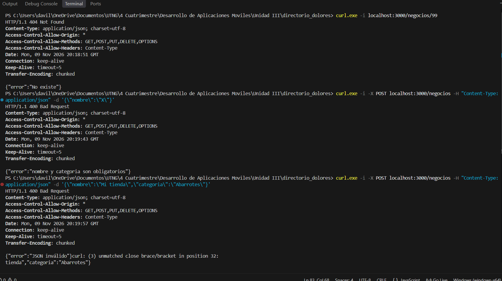
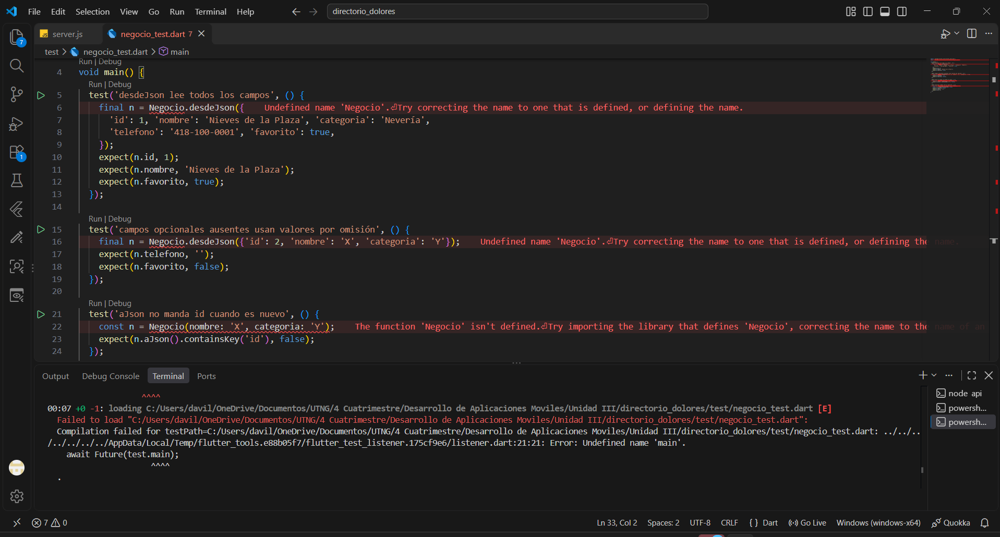
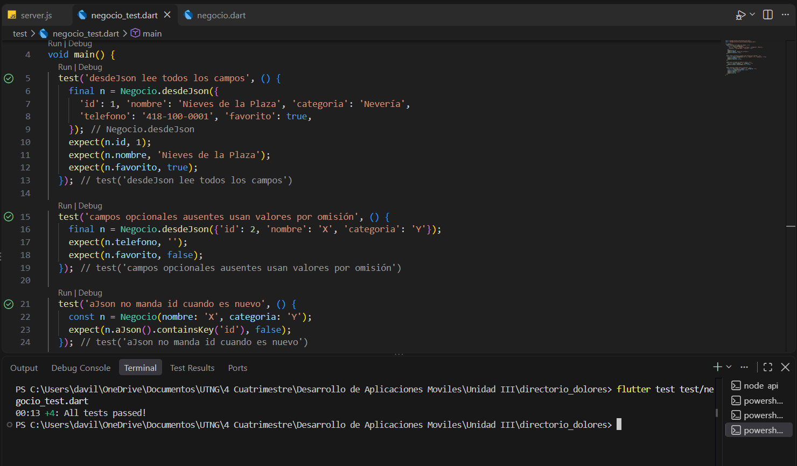
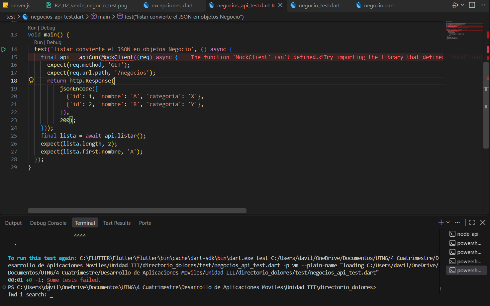
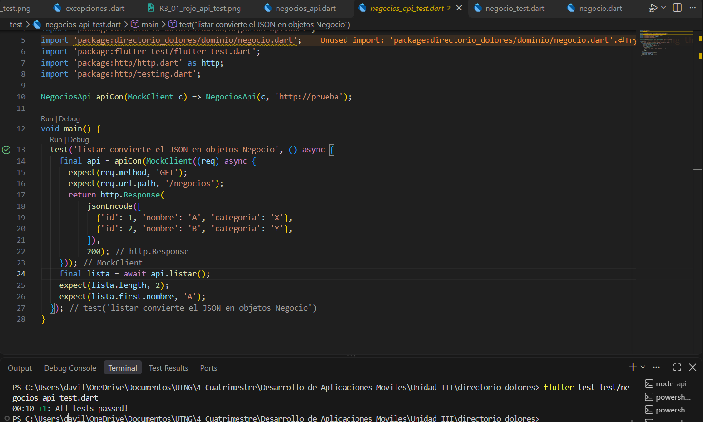
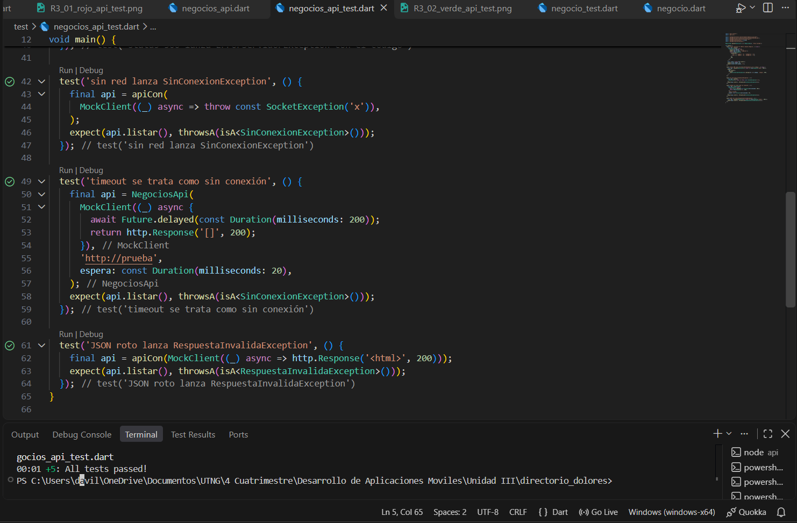

# directorio_dolores

# Directorio Dolorense: consumo de API local con TDD

## Ronda 1: La API (la cocina)

Servidor encendido:

## Ronda 2: Modelo Negocio (TDD)

Rojo: la prueba falla porque `negocio.dart` no existe.

Verde: se crea el modelo y las 4 pruebas pasan.

Estructura de la capa de dominio:

---

## Ronda 3: Cliente HTTP con MockClient (TDD)

Rojo: la prueba de `listar` falla porque `negocios_api.dart` no existe.

Verde: `listar` funciona.

Casos de falla (500, sin red, timeout y JSON roto):

Búsqueda, crear y eliminar:

Reto: prueba de `actualizar()` con PUT:

---

## Ronda 4 en adelante

(Se completa en los siguientes pasos.)
